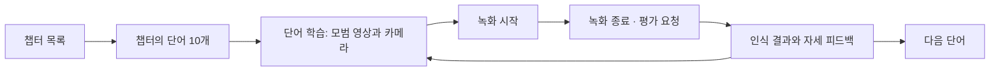

# 수어 학습 페이지 구현 도움집

현재 프로젝트의 Spring MVC·JSP 구조에서 챕터별 단어 학습 화면을 추가할 때 참고하는 문서다.
Python API는 구현되어 있다. 아래의 Spring 주소와 파일명은 구현안이며 아직 추가된 코드가 아니다.

## 1. 구현 범위와 기존 코드

| 구분 | 현재 상태 | 이번 페이지에서 할 일 |
|---|---|---|
| Python 수어 API | 100단어 모델, 10챕터, 모범 영상, 평가 제공 | 기존 API 호출 |
| Spring 학습 화면 | `LearnController`, `learn/main.jsp`, `jamo.jsp`, `dict.jsp` 존재 | 단어 학습 전용 화면 추가 |
| 기존 지문자 인식 | `SignRecognitionController`에서 프레임 단위 처리 | 기존 기능 유지 |
| 사용자 학습 이력 | 새 챕터 과정용 저장 정책은 정해지지 않음 | 로그인 사용자와 평가 결과 연결 |

기존 지문자 인식은 한 프레임을 처리하는 흐름이다. 이번 단어 학습은 **동작 전체를 촬영한 뒤 평가**한다.
지문자용 `/predict`와 단어용 `/api/v1/signs/predict`를 구분한다.

관련 파일의 현재 위치:

```text
spring-server/src/main/java/com/soldesk/controller/LearnController.java
spring-server/src/main/java/com/soldesk/controller/SignRecognitionController.java
spring-server/src/main/java/com/soldesk/config/SecurityConfig.java
spring-server/src/main/webapp/WEB-INF/views/learn/
python-server/sign_api/api.py
python-server/sign_api/video_api.py
```

Spring은 기존 `python.server.url` 설정과 RestTemplate 사용 방식을 이어가면 된다.
단어 API 호출 서비스와 DTO를 별도로 두면 지문자 요청·응답과 섞이지 않는다.

## 2. 화면 흐름



처음에는 영상 업로드 방식으로 연결한다. 브라우저는 촬영한 파일을 Spring으로 보내고,
Spring이 Python `/evaluate-video`에 전달한다. 이 방식은 브라우저에서 랜드마크를 추출하지 않는다.
녹화 중 손 검출 상태 안내까지 필요해지면 좌표 전송과 WebSocket을 추가한다.

### 챕터 목록

카드에 단원명·단어 수·사용자 진행 상태를 표시한다. 단원 정보는 Python에서,
사용자별 진행 상태는 Spring에서 가져와 `chapter_id`로 합친다.

| 챕터 ID | 과정 | 제목 | 단어 수 |
|---|---|---|---|
| chapter-01 | 기본70 | 첫 만남과 나의 의사 | 10 |
| chapter-02 | 기본70 | 모르더라도 계속 배우기 | 10 |
| chapter-03 | 기본70 | 나와 가까운 사람 | 10 |
| chapter-04 | 기본70 | 함께 먹고 취향 나누기 | 10 |
| chapter-05 | 기본70 | 일상에서 만나고 이동하기 | 10 |
| chapter-06 | 기본70 | 몸과 기분 돌보기 | 10 |
| chapter-07 | 기본70 | 좋아하는 것과 주변 세상 | 10 |
| chapter-08 | 확장1 | 감정을 더 세밀하게 | 10 |
| chapter-09 | 확장2 | 시간과 계획 나누기 | 10 |
| chapter-10 | 확장3 | 서로 돕고 관계 이어가기 | 10 |

현재 모델은 확장 과정까지 포함한 100단어를 모두 지원한다. 확장 챕터를 잠글지는 별도의 서비스 정책이다.

### 챕터 상세

단어 10개를 응답의 `order` 순서로 표시한다. 각 항목은 단어명·학습 상태·진입 버튼으로 구성한다.
선택된 단어는 한국어 이름 대신 `word_id`로 식별한다.

### 단어 학습

| 영역 | 표시·동작 |
|---|---|
| 상단 | 챕터명, 단어명, 챕터 내 순서 |
| 모범 영상 | 반복 재생, 일시정지, 처음부터, 느린 재생 |
| 사용자 화면 | 카메라 미리보기, 촬영 시간, 촬영 안내 |
| 조작 | 카메라 시작, 녹화 시작, 종료 후 평가, 다시 촬영 |
| 결과 | 목표 단어 일치 여부와 자세 피드백을 별도 표시 |
| 이동 | 이전 단어, 다음 단어, 챕터로 돌아가기 |

카메라 시작은 사용자가 버튼을 눌렀을 때 요청한다.
양쪽 어깨와 동작에 쓰는 손을 보여 달라고 안내한다. 한 손 수어의 쉬는 손을 들라고 요구하지 않는다.
양손 수어에서는 의미를 만드는 두 손이 보여야 한다.

## 3. Spring 주소와 Python 주소 연결

아래 Spring 주소는 신규 구현안이다. Python 주소는 현재 제공 중이다.

| 용도 | Spring 주소 구현안 | 연결할 Python 주소 |
|---|---|---|
| 챕터 화면 | `GET /learn/signs` | 챕터 목록 조회 |
| 챕터 화면 | `GET /learn/signs/chapters/{chapterId}` | 해당 챕터 조회 |
| 단어 화면 | `GET /learn/signs/chapters/{chapterId}/words/{wordId}` | 단어 상세 조회 |
| 챕터 JSON | `GET /api/sign-learning/chapters` | `GET /api/v1/signs/chapters` |
| 챕터 상세 JSON | `GET /api/sign-learning/chapters/{chapterId}` | `GET /api/v1/signs/chapters/{chapter_id}` |
| 단어 JSON | `GET /api/sign-learning/words/{wordId}` | `GET /api/v1/signs/words/{word_id}` |
| 모범 영상 | `GET /api/sign-learning/reference/{wordId}` | `GET /api/v1/signs/reference/{word_id}` |
| 영상 평가 | `POST /api/sign-learning/evaluate-video` | `POST /api/v1/signs/evaluate-video` |

JSP의 실제 템플릿은 예를 들어 `learn/signs/chapters.jsp`, `chapter.jsp`, `word.jsp`로 나눌 수 있다.
별도의 Spring API 컨트롤러·호출 서비스·DTO·화면용 JavaScript를 둔다.
기존 `/learn/dict`, `/learn/jamo`의 매핑과 응답을 바꾸지 않는다.

Spring 경로에 챕터와 단어를 함께 받으면 해당 단어가 그 챕터에 속하는지도 확인한다.
Python의 단어 상세 응답에 `chapter_id`가 있다.

## 4. 응답으로 화면 데이터 채우기

### 챕터 목록

`GET /api/v1/signs/chapters`:

| 필드 | 화면에서 사용 |
|---|---|
| `curriculum_version` | 학습 과정 버전 |
| `total_words` | 전체 단어 수 |
| `chapters[].chapter_id` | 챕터 식별자 |
| `order`, `title`, `stage` | 정렬, 제목, 기본/확장 표시 |
| `word_count` | 챕터 단어 수 |
| `detail_url` | Python 기준 상세 URL |

챕터 상세의 `words[]`에는 `word_id`, `label`, `chapter_id`, `order`,
`feedback_available`, `reference_video_url`, `evaluation_url`, `video_evaluation_url`이 있다.

### 단어 상세의 실제 응답 예시

`GET /api/v1/signs/words/WORD0115`:

```json
{
  "word_id": "WORD0115",
  "label": "커피",
  "chapter_id": "chapter-04",
  "feedback_available": true,
  "reference_video_url": "/api/v1/signs/reference/WORD0115",
  "evaluation_url": "/api/v1/signs/evaluate",
  "video_evaluation_url": "/api/v1/signs/evaluate-video",
  "capture": {
    "max_duration_ms": 20000,
    "min_frames": 16,
    "max_frames": 300,
    "max_video_bytes": 26214400,
    "mirrored": false,
    "both_hands_required": false,
    "shoulders_required": true,
    "guidance": "양쪽 어깨와 동작에 사용하는 손을 보여 주세요. 쉬는 손은 내려놓아도 됩니다."
  },
  "feedback": {
    "live": "tracking_quality_only",
    "completed_clip": "reference_geometry",
    "score_meaning": "classification_softmax_not_posture_accuracy"
  }
}
```

DTO의 Java 필드는 camelCase를 써도 되지만 `word_id` 등 JSON 필드는 `@JsonProperty`로 연결한다.
기존 지문자 DTO에 영향을 주도록 전역 JSON 이름 규칙을 바꾸지 않는다.

Python이 반환하는 URL은 Python 서비스 기준이다. 브라우저에서는 Spring 프록시 URL을 사용한다.
예를 들어 `reference_video_url`은 Spring의 `/api/sign-learning/reference/WORD0115`로 매핑한다.
JSP 배포 경로가 루트가 아닐 수 있으므로 `<c:url>` 또는 contextPath를 반영한다.

## 5. 모범 영상 중계

브라우저의 `<video>`는 Spring의 영상 주소를 사용한다. Spring은 고정된 Python 서비스 주소에
검증한 `word_id`를 붙여 요청한다. 클라이언트가 보낸 임의 URL을 대신 요청하는 구조로 만들지 않는다.

Python 서비스 키가 설정되어 있으면 Spring → Python 요청에만 `X-Sign-Api-Key`를 붙인다.
브라우저의 영상 태그에 키를 붙이거나 URL 쿼리로 전달하지 않는다.

영상 탐색을 유지하려면 Spring이 다음 내용을 중계해야 한다.

- 브라우저 요청의 `Range` 헤더.
- Python 응답의 200/206/416 상태 코드.
- `Content-Type`, `Content-Length`, `Accept-Ranges`, `Content-Range` 헤더.
- 영상 본문 스트림. MP4를 JSON이나 Base64로 바꾸지 않는다.

단어가 바뀌면 영상 소스를 갱신하고 재생 위치·속도·이전 결과를 초기화한다.
모범 영상이 준비되지 않았으면 녹화 시작 버튼을 비활성화한다.

## 6. 카메라와 녹화

### 준비

1. HTTPS 또는 localhost 환경에서 카메라 접근을 요청한다.
2. 오디오는 받지 않는다. 시작 설정은 640×360 또는 1280×720 정도로 잡는다.
3. 실제 영상 크기를 확인한다. 브라우저의 `ideal` 해상도 요청은 보장값이 아니다.
4. 업로드 영상은 1920×1080 이하, 20초 이하, 25MiB 이하로 맞춘다.
5. 화면을 거울처럼 보여주려면 미리보기 표시만 반전한다. 저장 영상은 반전하지 않는다.

### 녹화

`MediaRecorder.isTypeSupported()`로 브라우저가 지원하는 MIME을 확인한다.
현재 자동 검증은 MP4 파일로 수행했다. 실제 선택한 WebM/MP4 코덱은 배포 서버에서도 시험한다.
Blob의 MIME과 파일 확장자를 일치시키며 파일명만 `.mp4`로 바꿔 코덱을 변환하지 않는다.

녹화 종료 후 마지막 `dataavailable`과 `stop` 처리가 끝난 시점에 Blob을 만든다.
동작 전체를 보통 2~10초 촬영하고, 20초를 넘기기 전에 자동 종료한다.
정지 화면 한 장을 `/evaluate-video`에 보내지 않는다.

화면 상태는 `준비 → 녹화 중 → 평가 중 → 결과`로 관리한다.
평가 중에는 중복 제출과 단어 변경을 막거나, 변경 시 이전 요청을 무효 처리한다.
페이지를 나갈 때 녹화·타이머를 정리하고 카메라 트랙을 중지한다.

## 7. 영상 평가 요청

브라우저 → Spring → Python 모두 `multipart/form-data`로 전달한다.

| 필드 | 값 |
|---|---|
| `target_word_id` | 현재 단어 코드. 예: `WORD0115` |
| `attempt_id` | 시도 식별자. 영문·숫자·`_`·`-`, 1~80자 |
| `video` | 촬영한 Blob/파일 |
| `use_llm` | 초기에는 `false`. 규칙 기반 피드백만 사용 |

사용자 ID와 `chapter_id`는 Spring이 이력 관리에 사용한다. Python에 보낼 필드는 위 표와 맞춘다.
Python은 `attempt_id`를 그대로 반환하지만 중복 요청을 제거하거나 이력을 저장하지 않는다.

브라우저 요청의 핵심 형태는 다음과 같다. Spring 평가 주소를 구현한 뒤 연결한다.

```javascript
async function submitAttempt(blob, fileName, wordId, attemptId, evaluateUrl, csrfHeaders) {
  const form = new FormData();
  form.append('target_word_id', wordId);
  form.append('attempt_id', attemptId);
  form.append('use_llm', 'false');
  form.append('video', blob, fileName);

  const response = await fetch(evaluateUrl, {
    method: 'POST',
    credentials: 'same-origin',
    headers: csrfHeaders,
    body: form
  });
  const body = await response.json();
  if (!response.ok) throw { status: response.status, body };
  return body;
}
```

FormData 요청의 `Content-Type`은 직접 지정하지 않는다. 브라우저가 boundary를 포함해 만든다.
현재 `SecurityConfig`의 `/api/sign/**` 예외는 제안한 `/api/sign-learning/**`와 다른 경로다.
JSP에서 전달받은 CSRF 헤더 이름·토큰을 요청에 넣고, 새 경로의 접근 권한도 명시한다.
로그인 사용자 식별은 Spring 인증 정보에서 가져온다.

Spring에서는 multipart 요청을 받은 뒤 파일의 이름·본문·Content-Type을 Python으로 전달한다.
단순 문자열이나 JSON으로 바꿔 보내지 않는다. Python 서비스 키는 이 호출에 추가한다.
Spring·서블릿·앞단 프록시의 업로드 크기와 응답 대기 시간도 함께 맞춘다.
파일 25MiB에는 multipart 포장 크기가 더해지므로 전체 요청 한도에는 여유가 필요하다.

## 8. 인식 결과와 자세 피드백 표시

HTTP 성공 여부를 확인한 뒤에도 `status`를 다시 확인한다. 검출 부족은 HTTP 200의 `retry`다.

| 조건 | 화면 처리 |
|---|---|
| `status == retry` | 재촬영 안내. `recognition`을 읽지 않고 오답으로 저장하지 않음 |
| `status == ok`, `target_matches_top1 == true` | “목표 단어로 인식됐어요.” |
| `status == ok`, `target_matches_top1 == false` | “다른 단어로 인식됐어요.”와 예측 단어 표시 |
| `feedback.status == advice` | 인식 결과와 별도로 `feedback.message` 표시 |
| `feedback.status == no_reliable_correction` | 응답 문구 표시. 완벽한 자세나 합격으로 바꾸지 않음 |
| `feedback.status == reference_unavailable` | 인식 결과는 표시하고 자세 비교는 이용 불가로 안내 |

`recognition.top3[].score`는 분류 softmax 값이다. “자세 정확도 92점”으로 표시하지 않는다.
목표 단어로 인식되어도 교정 문구가 나올 수 있다. 반대로 교정 문구가 없다고 이수 처리하지 않는다.
엄지·표정·수어 문법 전체를 채점하는 시스템은 아니다.

교정 문구는 텍스트로 표시한다. LLM 사용 시에도 HTML로 실행하거나 렌더링할 필요가 없다.
최종 결과에는 요청한 `attempt_id`, `target_word_id`가 맞는지 확인한다.
단어를 바꾼 뒤 도착한 이전 결과로 현재 화면을 덮어쓰지 않는다.
브라우저 요청 취소가 Python 작업의 즉시 중단을 뜻하지는 않는다. 별도의 Python 취소 API는 없다.

### 검출 부족의 실제 응답 예시

아래는 손과 어깨가 검출되지 않는 좌표를 전송한 실제 응답이다.

```json
{
  "attempt_id": "guide-example-001",
  "status": "retry",
  "quality": {
    "hand_frames": 0,
    "shoulder_frames": 0,
    "total_frames": 20,
    "active_hand_frames": 0,
    "excluded_resting_slots": []
  },
  "model_id": "curriculum100_seated_active_v2",
  "target_word_id": "WORD0115",
  "input_policy": "seated_active_v2",
  "recognition": null,
  "feedback": {
    "status": "insufficient_tracking",
    "message": "동작에 사용하는 손과 양쪽 어깨가 보이도록 전체 동작을 다시 촬영해 주세요. 쉬는 손은 내려놓아도 됩니다."
  }
}
```

## 9. 오류 상태

| HTTP | 처리 |
|---|---|
| 404 | 없는 챕터·단어·영상. 목록으로 돌아가 새로 조회 |
| 413 | 영상 크기 초과. 짧게 촬영하거나 용량 축소 |
| 422 | 요청 형식·영상 제한·디코딩 문제. 요청 필드와 실제 코덱 확인 |
| 429 | 다른 평가 처리 중. 녹화를 보관하고 재시도 버튼 제공 |
| 503 | 수어 모델 준비 안 됨. Python health 확인 후 다시 시도 |
| 네트워크 오류·시간 초과 | 결과가 확정되지 않았음을 안내. 중복 이력 저장 방지 |

파일을 유지한 재전송은 같은 촬영 시도로 취급할 수 있지만 Python은 이를 중복 제거하지 않는다.
Spring 저장 단계에서 `(member_id, attempt_id)`를 중복 처리하지 않도록 한다.
Python 검증 오류의 `detail`은 문자열 또는 배열일 수 있으므로 화면용 오류로 정리한다.

## 10. 학습 이력과 이수 정책

Spring에 저장할 항목 예시:

| 항목 | 용도 |
|---|---|
| 인증된 사용자 ID, `attempt_id` | 시도 식별·중복 방지 |
| `curriculum_version`, `chapter_id`, `word_id` | 학습 과정·대상 |
| `model_id`, `input_policy` | 어떤 모델로 판정했는지 구분 |
| 처리 상태, 목표 단어 일치 여부, 예측 단어 | 결과 요약 |
| 피드백 상태·문구, 필요한 측정 결과 | 복습 화면 |
| 요청·완료 시각 | 최신 이력과 처리 시간 |

“시도함”, “목표 단어로 인식됨”, “학습 완료”를 별도 상태로 둔다.
`retry`는 촬영 실패이고, HTTP 오류는 평가 미완료다. 둘을 모델의 오답으로 집계하지 않는다.
학습 완료를 사용자가 눌러 정할지, 목표 인식 횟수 등으로 정할지는 서비스 명세에서 결정한다.
그 기준을 정하기 전에는 분류 점수 하나로 자동 이수시키지 않는다.

## 11. 좌표·WebSocket 방식이 필요한 경우

첫 구현에 필수는 아니다. 녹화 중 손/어깨 검출 상태를 보여주려는 경우 추가한다.

- HTTP 좌표 평가: `POST /api/v1/signs/evaluate`.
- 좌표 수집과 검출 상태: `WS /api/v1/signs/practice`.
- WS 순서: `start → frames → tracking → … → finish → result`.
- 배치는 1~15개 프레임, 누적 최대 300개. tracking 응답을 받고 다음 배치를 보낸다.
- 양쪽 손이 아니라 동작 손이 검출돼도 촬영할 수 있다.
- 완료 후 피드백을 주며 동작 단계별 실시간 교정을 제공하지 않는다.

`hands`는 MediaPipe Left/Right 슬롯의 각 21개 `[x,y,z]`, `pose`는 33개 `[x,y,visibility]`다.
포즈의 세 번째 값에 z를 넣지 않는다. 좌표는 원본 비율·비반전 상태로 전송한다.
다른 브라우저 랜드마크 모델을 쓰면 학습 추출기와 비교 검증해야 한다.
Spring은 브라우저 연결마다 Python WS 하나를 중계하고 양쪽 종료를 연결한다.

## 12. 연결 완료 확인

1. Python `/api/v1/signs/health`에서 `ready: true`, 100클래스·100비교 기준·10챕터와 새 모델 ID 확인.
2. 각 챕터가 단어 10개를 반환하고 전체 WORD 코드가 중복 없이 100개인지 확인.
3. Spring 영상 주소에서 재생·탐색·반복 재생 확인.
4. 브라우저에서 선택한 실제 녹화 코덱으로 업로드 평가 확인.
5. 한 손 수어에서 쉬는 손을 내려놓아도 제출·평가가 가능한지 확인.
6. 손이 안 보이는 녹화는 재촬영으로 처리하고 점수·오답을 만들지 않는지 확인.
7. 단어 변경·중복 클릭·느린 응답이 다른 시도의 결과를 덮어쓰지 않는지 확인.
8. CSRF·인증·로그인 세션·진도 저장과 앞단 업로드 제한 확인.

Python 검사:

```powershell
cd C:\sign-bridge\python-server
python -m unittest discover -s tests -v
python tests/smoke_sign_word_video.py
```

검증된 범위는 Python API 검사와 MP4 영상 입력이다. 위의 Spring 화면·브라우저 녹화 연동은 구현 후 확인한다.
세부 API 필드는 [SIGN_WORD_API.md](SIGN_WORD_API.md), 실제 조회 응답은
[SIGN_LEARNING_API_EXAMPLES.json](SIGN_LEARNING_API_EXAMPLES.json)에서 확인할 수 있다.
